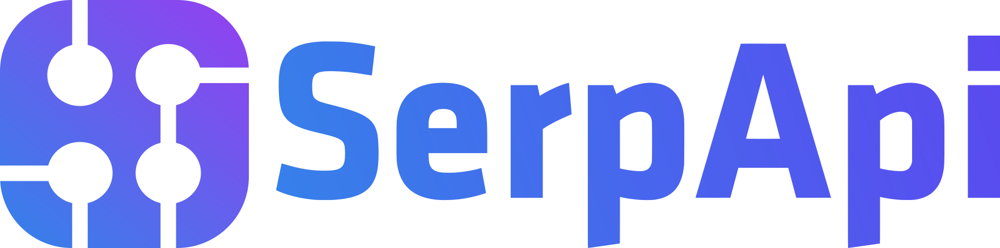

> **[中文化] claude-mem**
>
> 此项目是 [thedotmack/claude-mem](https://github.com/thedotmack/claude-mem) 的中文翻译版本。
> - 原项目 Stars: 105900
> - 主语言: TypeScript
> - 许可证: Apache-2.0
> - 翻译日期: 2026-10-31
> - 原始 README: [README_en.md](README_en.md)
>
> 说明：下方 README 正文为**原项目文档的中文翻译**，力求忠于原文；本页顶部的「中文快速上手」为**面向中文用户的补充导读**（非原文内容），目的是让你不用读完整篇 README 就能先把项目跑起来。
>
> 如有翻译不准确之处，欢迎提 Issue 或 PR。

---


## 🚀 中文快速上手（补充导读，非原文）

### 这是什么 / 解决什么问题

Claude-Mem 是一个为 [Claude Code](https://claude.com/claude-code) 打造的「持久化记忆压缩系统」。它自动捕获 Claude Code 会话中的工具使用观察（observations），生成语义摘要，并让这些记忆在后续会话中可用，从而让 Claude 在会话结束或重连后仍能保持对项目的知识连续性。简单说，它解决的是「每次开新会话，Claude 就忘了之前干过什么」的痛点。

### 快速上手（最短路径）

1. 用单条命令安装（原文给出的主安装命令）：
   ```bash
   npx claude-mem install
   ```
2. 安装器会先完成环境配置，然后要求你在浏览器中登录 claude-mem（邮箱 magic link，无需信用卡）。登录会为你的账户分配 memory key，并解锁带 **30 天免费试用**的 claude-mem observer。
3. 登录后选择你的记忆提供方（memory provider）：claude-mem observer、你自己的 OpenRouter 或 Gemini key，或你的 Anthropic 套餐。
4. 若不想登录，可显式传入 `--provider` 参数，或设置 `CLAUDE_MEM_ONLINE_OPTIN=false`，或在 CI/非交互环境中运行（原文此处被截断，后续细节未说明）。
5. 针对 Grok Bot 的安装方式（原文单独给出）：
   ```bash
   npx claude-mem install --ide grok-bot
   ```

### 环境要求

- **操作系统**：原文未说明具体支持哪些操作系统。
- **硬件**：原文未说明。
- **依赖**：Node.js，版本要求 `>=20.0.0`（来自 README 徽章与 package.json 的 `engines` 字段，原文写作 `^20.19.` 处被截断，完整版本约束未说明）。
- **版本要求**：项目当前版本 15.7.0；主语言 TypeScript；许可证 Apache-2.0。
- **网络提示**：安装通过 `npx` 从 npm 拉取，国内网络环境如遇下载缓慢，可考虑更换 npm 镜像源（此为通用提示，原文未专门说明）。

### 常见坑与注意事项

- **需要登录/账号**：默认安装流程会要求浏览器登录 claude-mem 并分配 memory key；不想登录需显式传 `--provider` 或设置 `CLAUDE_MEM_ONLINE_OPTIN=false`。
- **免费试用有期限**：claude-mem observer 为 30 天免费试用，试用结束后记忆功能会自动回退到你的 Anthropic 套餐，除非你订阅。
- **Grok Bot 的特殊限制**：Grok Bot 没有 host hooks，因此改为监视聊天日志文件；默认使用托管的 CMEM Pro，本地 observer 需通过 `--provider host` 显式开启；安装该插件不会安装 Cursor。
- **Awareness 推送可关闭**：Grok Bot 的 awareness 推送会把 needle observations 写入 `memory/log/YYYY-MM.md`，可用 `CLAUDE_MEM_GROK_BOT_AWARENESS_ENABLED=false` 关闭；该功能不写入 `profile.md`、user-memory 或 project memory。

---


---

<h1 align="center">
  <br>
  <a href="https://github.com/thedotmack/claude-mem">
    <picture>
      <source media="(prefers-color-scheme: dark)" srcset="docs/public/claude-mem-logo-for-dark-mode.webp">
      <source media="(prefers-color-scheme: light)" srcset="docs/public/claude-mem-logo-for-light-mode.webp">
      
    </picture>
  </a>
</h1>

<p align="center">
  
  &nbsp;&nbsp;&nbsp;
  
  &nbsp;&nbsp;&nbsp;
  
</p>

<p align="center">
  <a href="docs/i18n/README.zh.md">🇨🇳 中文</a> •
  <a href="docs/i18n/README.zh-tw.md">🇹🇼 繁體中文</a> •
  <a href="docs/i18n/README.ja.md">🇯🇵 日本語</a> •
  <a href="docs/i18n/README.pt.md">🇵🇹 Português</a> •
  <a href="docs/i18n/README.pt-br.md">🇧🇷 Português</a> •
  <a href="docs/i18n/README.ko.md">🇰🇷 한국어</a> •
  <a href="docs/i18n/README.es.md">🇪🇸 Español</a> •
  <a href="docs/i18n/README.de.md">🇩🇪 Deutsch</a> •
  <a href="docs/i18n/README.fr.md">🇫🇷 Français</a> •
  <a href="docs/i18n/README.he.md">🇮🇱 עברית</a> •
  <a href="docs/i18n/README.ar.md">🇸🇦 العربية</a> •
  <a href="docs/i18n/README.ru.md">🇷🇺 Русский</a> •
  <a href="docs/i18n/README.pl.md">🇵🇱 Polski</a> •
  <a href="docs/i18n/README.cs.md">🇨🇿 Čeština</a> •
  <a href="docs/i18n/README.nl.md">🇳🇱 Nederlands</a> •
  <a href="docs/i18n/README.tr.md">🇹🇷 Türkçe</a> •
  <a href="docs/i18n/README.uk.md">🇺🇦 Українська</a> •
  <a href="docs/i18n/README.vi.md">🇻🇳 Tiếng Việt</a> •
  <a href="docs/i18n/README.tl.md">🇵🇭 Tagalog</a> •
  <a href="docs/i18n/README.id.md">🇮🇩 Indonesia</a> •
  <a href="docs/i18n/README.th.md">🇹🇭 ไทย</a> •
  <a href="docs/i18n/README.hi.md">🇮🇳 हिन्दी</a> •
  <a href="docs/i18n/README.bn.md">🇧🇩 বাংলা</a> •
  <a href="docs/i18n/README.ur.md">🇵🇰 اردو</a> •
  <a href="docs/i18n/README.ro.md">🇷🇴 Română</a> •
  <a href="docs/i18n/README.sv.md">🇸🇪 Svenska</a> •
  <a href="docs/i18n/README.it.md">🇮🇹 Italiano</a> •
  <a href="docs/i18n/README.el.md">🇬🇷 Ελληνικά</a> •
  <a href="docs/i18n/README.hu.md">🇭🇺 Magyar</a> •
  <a href="docs/i18n/README.fi.md">🇫🇮 Suomi</a> •
  <a href="docs/i18n/README.da.md">🇩🇰 Dansk</a> •
  <a href="docs/i18n/README.no.md">🇳🇴 Norsk</a>
</p>

<h4 align="center">为 <a href="https://claude.com/claude-code" target="_blank">Claude Code</a> 构建的持久化记忆压缩系统。</h4>

<p align="center">
  <a href="LICENSE">
    
  </a>
  <a href="package.json">
    
  </a>
  <a href="package.json">
    
  </a>
  <a href="https://github.com/thedotmack/awesome-claude-code">
    
  </a>
</p>

<p align="center">
  <a href="https://trendshift.io/repositories/15496" target="_blank">
    <picture>
      <source media="(prefers-color-scheme: dark)" srcset="https://raw.githubusercontent.com/thedotmack/claude-mem/main/docs/public/trendshift-badge-dark.svg">
      <source media="(prefers-color-scheme: light)" srcset="https://raw.githubusercontent.com/thedotmack/claude-mem/main/docs/public/trendshift-badge.svg">
      
    </picture>
  </a>
</p>

<br>

<table align="center">
  <tr>
    <td align="center">
      <a href="https://github.com/thedotmack/claude-mem">
        <picture>
          
        </picture>
      </a>
    </td>
    <td align="center">
      <a href="https://www.star-history.com/#thedotmack/claude-mem&Date">
        <picture>
          <source
            media="(prefers-color-scheme: dark)"
            srcset="https://api.star-history.com/image?repos=thedotmack/claude-mem&type=date&theme=dark&legend=top-left"
          />
          <source
            media="(prefers-color-scheme: light)"
            srcset="https://api.star-history.com/image?repos=thedotmack/claude-mem&type=date&legend=top-left"
          />
          
        </picture>
      </a>
    </td>
  </tr>
</table>

<p align="center">
  <a href="#快速开始">快速开始</a> •
  <a href="#工作原理">工作原理</a> •
  <a href="#mcp-搜索工具">搜索工具</a> •
  <a href="#文档">文档</a> •
  <a href="#配置">配置</a> •
  <a href="#故障排查">故障排查</a> •
  <a href="#许可证">许可证</a>
</p>

<p align="center">
  Claude-Mem 自动捕获工具使用观察、生成语义摘要，并将其提供给后续会话，从而无缝保留跨会话的上下文。这让 Claude 即使在会话结束或重新连接后，仍能保持对项目的知识连续性。
</p>

---

## 快速开始

为 Grok Bot 安装 claude-mem：

```bash
npx claude-mem install --ide grok-bot
```

Grok Bot 没有宿主 Hook，因此我们监视聊天日志文件。默认使用 CMEM Pro（托管记忆）。本地观察器需主动启用：`--provider host`。安装此插件不会安装 Cursor。

**感知推送试点（LFG + Orifice）：** 关键观察（`decision`、`bugfix`、`security_alert`、`sensitive`）会以带日期的 `- YYYY-MM-DD [awareness] …` 行追加到该机器人的 `memory/log/YYYY-MM.md`。Grok Bot 已会从磁盘重新读取日志。此功能不会写入 `profile.md`、用户记忆或项目记忆。可通过 `CLAUDE_MEM_GROK_BOT_AWARENESS_ENABLED=false` 禁用。

使用单条命令安装：

```bash
npx claude-mem install
```

安装器会先完成所有设置，然后要求你在浏览器中登录 claude-mem（邮箱魔法链接——无需信用卡）。登录会为你的账户配置记忆密钥，并解锁带 **30 天免费试用** 的 **claude-mem 观察器**：记忆在套餐之外运行，因此你的套餐可用量最多可提升 100%。免费试用结束后，除非你订阅，否则记忆会自动回退到你的 Anthropic 套餐。登录后你选择记忆提供方——claude-mem 观察器、你自己的 OpenRouter 或 Gemini 密钥，或你的 Anthropic 套餐。

想跳过登录？传入显式的 `--provider` 标志、设置 `CLAUDE_MEM_ONLINE_OPTIN=false`，或在 CI/非交互式 shell 中运行——安装器会在无任何账户交互的情况下完成。

或为 OpenCode 安装：

```bash
npx claude-mem install --ide opencode
```

适用于 OpenCode 1.3.4 或更高版本，包括 OpenCode 2。安装后重启 OpenCode。

或为 **T3 Code** 安装（Codex 和 Claude Code 提供方）：

```bash
npx claude-mem install --ide t3code
```

安装器会发现 T3 Code 已启用的提供方，在其配置的 home 目录中注册原生 Claude-Mem 插件，并支持 T3 管理的 Codex。重启 T3 Code，在提示时信任提供方的 Hook，然后开始新线程。自定义服务器设置、状态和卸载请参阅 [T3 Code 集成指南](https://docs.claude-mem.ai/t3code-integration)。

或为 Antigravity CLI 安装（[设置指南](https://docs.claude-mem.ai/antigravity-cli/setup)）：

```bash
npx claude-mem install --ide antigravity
```

或为 OMP（Oh My Pi）安装：

```bash
npx claude-mem install --ide omp
```

或安装原生 Pi 扩展或 DeepSeek Harness 插件：

```bash
npx claude-mem install --ide pi
npx claude-mem install --ide dsh --dsh-profile tui
```

Pi 和 DeepSeek Harness 使用 worker 运行时。捕获、召回和故障排查请参阅[原生 harness 设置](docs/native-harness-integrations.md)。

或在 Claude Code 内从插件市场安装：

```bash
/plugin marketplace add thedotmack/claude-mem

/plugin install claude-mem
```

重启 Claude Code。之前会话的上下文会自动出现在新会话中。

> **注意：** Claude-Mem 也发布在 npm 上，但 `npm install -g claude-mem` 仅安装 **SDK/库**——它不会注册插件 Hook 或设置 worker 服务。请始终通过 `npx claude-mem install` 或上述 `/plugin` 命令安装。

### 🦞 OpenClaw 网关

使用单条命令将 claude-mem 安装为 [OpenClaw](https://openclaw.ai) 网关上的持久化记忆插件：

```bash
curl -fsSL https://install.cmem.ai/openclaw.sh | bash
```

安装器会处理依赖、插件设置、AI 提供方配置、worker 启动，以及可选的实时观察推送到 Telegram、Discord、Slack 等。详情请参阅 [OpenClaw 集成指南](https://docs.claude-mem.ai/openclaw-integration)。

**核心特性：**

- 🧠 **持久化记忆** - 上下文跨会话保留
- 📊 **渐进式披露** - 分层记忆检索，token 成本可见
- 🔍 **智能搜索（默认）** - 使用三步 mem-search 技能查询项目历史
- 🖥️ **本地 My Work** - 在启动时打印的 worker URL 中查看实时请求、进度、人工交接和已保存的审查队列。[指南](https://docs.claude-mem.ai/usage/my-work)。记忆、会话和设置仍位于 `/viewer`。
- 👥 **TeamBrain** - My Work 旁的可选共享工作区，包含真实的团队工作列表、成员归属和关联发现。每个人自行选择共享内容；个人请求和审查笔记保持独立。[创建团队](https://cmem.ai/teambrain/start)。
- 💻 **Claude Desktop 技能** - 从 Claude Desktop 对话中搜索记忆
- 🔒 **隐私控制** - 使用 `<private>` 标签将敏感内容排除在存储之外
- 🖼️ **截图（需主动启用，默认关闭）** - 将转换后的工具截图副本保存在 `~/.claude-mem/media-v1/` 下，仅在 Cloud Sync 开启时上传到 cmem.ai，仅在单独启用图像推理时发送给观察器模型（[详情](https://docs.claude-mem.ai/configuration#screenshots-and-images-opt-in)）
- ⚙️ **上下文配置** - 精细控制注入哪些上下文
- 🤖 **自动运行** - 无需手动干预
- 🔗 **引用** - 通过 worker API 使用 ID 引用过去的观察，或在 Web 查看器中查看全部

---

## 文档

📚 **[查看完整文档](https://docs.claude-mem.ai/)** - 在官网浏览

### 入门

- **[安装指南](https://docs.claude-mem.ai/installation)** - 快速开始与高级安装
- **[使用指南](https://docs.claude-mem.ai/usage/getting-started)** - Claude-Mem 如何自动工作
- **[搜索工具](https://docs.claude-mem.ai/usage/search-tools)** - 用自然语言查询项目历史
- **[Cloud Sync](https://docs.claude-mem.ai/cloud-sync)** - 将记忆备份到 cmem.ai——无需守护进程，worker 在写入时同步

### 最佳实践

- **[上下文工程](https://docs.claude-mem.ai/context-engineering)** - AI agent 上下文优化原则
- **[渐进式披露](https://docs.claude-mem.ai/progressive-disclosure)** - Claude-Mem 上下文预热策略背后的理念

### 架构

- **[概览](https://docs.claude-mem.ai/architecture/overview)** - 系统组件与数据流
- **[架构演进](https://docs.claude-mem.ai/architecture-evolution)** - 从 v3 到 v5 的历程
- **[Hook 架构](https://docs.claude-mem.ai/hooks-architecture)** - Claude-Mem 如何使用生命周期 Hook
- **[Hook 参考](https://docs.claude-mem.ai/architecture/hooks)** - 每个 Hook 条目详解
- **[Worker 服务](https://docs.claude-mem.ai/architecture/worker-service)** - HTTP API 与 Bun 管理
- **[数据库](https://docs.claude-mem.ai/architecture/database)** - SQLite Schema 与 FTS5 搜索
- **[搜索架构](https://docs.claude-mem.ai/architecture/search-architecture)** - 基于 Chroma 向量数据库的混合搜索

### 配置与开发

- **[配置](https://docs.claude-mem.ai/configuration)** - 环境变量与设置
- **[开发](https://docs.claude-mem.ai/development)** - 构建、测试、贡献
- **[故障排查](https://docs.claude-mem.ai/troubleshooting)** - 常见问题与解决方案

---

## 工作原理

**核心组件：**

1. **生命周期 Hook** - SessionStart、UserPromptSubmit、PreToolUse、PostToolUse、Stop、SessionEnd。每个都是一个无 shell 命令 `claude-mem hook claude-code <event>`，由安装器放到 PATH 上的小型启动器运行
2. **智能安装** - 带缓存的依赖检查器（在 `claude --init` / `--maintenance` 时运行 Setup Hook，外加 `npx claude-mem install` / `repair`）
3. **Worker 服务** - 本地 HTTP API，带 Web 查看器 UI 和搜索端点，由 Bun 管理
4. **SQLite 数据库** - 存储会话、观察、摘要
5. **mem-search 技能** - 带渐进式披露的自然语言查询
6. **Chroma 向量数据库** - 混合语义 + 关键词搜索，实现智能上下文检索

详情请参阅[架构概览](https://docs.claude-mem.ai/architecture/overview)。

---

## MCP 搜索工具

Claude-Mem 通过 **4 个 MCP 工具** 提供智能记忆搜索，遵循 token 高效的 **3 层工作流模式**：

**3 层工作流：**

1. **`search`** - 获取带 ID 的紧凑索引（约 50-100 token/结果）
2. **`timeline`** - 获取感兴趣结果前后的时间线上下文
3.